# Sơ Đồ Quan Hệ Thực Thể (ERD) - Hệ Thống Quản Lý Tuyển Dụng AI

Hệ thống được thiết kế theo tiêu chuẩn doanh nghiệp gồm **17 thực thể** chuẩn hóa (3NF), sử dụng **UUID (CHAR(36))** làm khóa chính, hỗ trợ **xóa mềm (Soft Delete)** qua trường `deleted_at`, và duy trì tính toàn vẹn của dữ liệu thống kê lịch sử qua `ON DELETE RESTRICT`.

---

## 1. Sơ Đồ Mermaid ERD

```mermaid
erDiagram
    TaiKhoan ||--o{ PhongBan : "quan_ly"
    PhongBan ||--o{ TaiKhoan : "nhan_vien_thuoc"
    PhongBan ||--o{ ViTriTuyenDung : "co_vi_tri"
    ViTriTuyenDung ||--o{ TinTuyenDung : "dang_tin"
    TaiKhoan ||--o{ TinTuyenDung : "phu_trach"
    TaiKhoan ||--o| UngVien : "lien_ket_tai_khoan"
    UngVien ||--o{ HoSoCV : "so_huu"
    TinTuyenDung ||--o{ LuotUngTuyen : "nhan_ho_so"
    UngVien ||--o{ LuotUngTuyen : "ung_tuyen"
    HoSoCV ||--o{ LuotUngTuyen : "su_dung_cv"
    NguonTuyenDung ||--o{ LuotUngTuyen : "nguon_goc"
    LuotUngTuyen ||--o{ LichPhongVan : "to_chuc_pv"
    TaiKhoan ||--o{ LichPhongVan : "phong_van_vien"
    LichPhongVan ||--o{ DanhGiaPhongVan : "ket_qua_danh_gia"
    TaiKhoan ||--o{ DanhGiaPhongVan : "nguoi_danh_gia"
    UngVien ||--o{ HoSoTiemNang : "luu_talent_pool"
    ViTriTuyenDung ||--o{ HoSoTiemNang : "phu_hop_vi_tri"
    TaiKhoan ||--o{ ThongBao : "nhan_thong_bao"
    LuotUngTuyen ||--o{ KetQuaAI : "ai_danh_gia"
    HoSoCV ||--o{ KetQuaAI : "ai_trich_xuat"
    TaiKhoan ||--o{ BaoCaoTuyenDung : "lap_bao_cao"
    LuotUngTuyen ||--o{ SuKienTrangThai : "lich_su_trang_thai"
    TaiKhoan ||--o{ SuKienTrangThai : "nguoi_chuyen_trang_thai"
    TinTuyenDung ||--o{ KhoanChi : "chi_phi_tin"
    NguonTuyenDung ||--o{ KhoanChi : "chi_phi_kenh"
    TaiKhoan ||--o{ KhoanChi : "nguoi_duyet_chi"
    UngVien ||--o{ TuongTac : "lich_su_tuong_tac"
    TaiKhoan ||--o{ TuongTac : "nhan_vien_tuong_tac"

    TaiKhoan {
        char(36) id PK "UUID"
        string ten_dang_nhap UK
        string mat_khau_hash
        string email UK
        string ho_ten
        enum vai_tro "ADMIN | RECRUITER | CANDIDATE"
        enum trang_thai "HOAT_DONG | KHOA"
        char(36) phong_ban_id FK
        timestamp deleted_at "Soft-delete"
    }

    PhongBan {
        char(36) id PK "UUID"
        string ma_phong_ban UK
        string ten_phong_ban
        char(36) nguoi_quan_ly_id FK
        timestamp deleted_at "Soft-delete"
    }

    ViTriTuyenDung {
        char(36) id PK "UUID"
        char(36) phong_ban_id FK
        string ma_vi_tri UK
        string ten_vi_tri
        text yeu_cau "Dữ liệu đối sánh AI"
        enum trang_thai "MO | DONG | DA_LAP_DAY"
        timestamp deleted_at "Soft-delete"
    }

    TinTuyenDung {
        char(36) id PK "UUID"
        char(36) vi_tri_id FK
        string tieu_de
        text noi_dung
        date han_nop
        char(36) nguoi_phu_trach_id FK
        enum trang_thai "NHAP | DANG_TUYEN | TAM_DUNG | DONG"
        timestamp deleted_at "Soft-delete"
    }

    UngVien {
        char(36) id PK "UUID"
        char(36) tai_khoan_id FK
        string ho_ten
        string email UK
        string so_dien_thoai
        text ky_nang_chinh
        timestamp deleted_at "Soft-delete"
    }

    HoSoCV {
        char(36) id PK "UUID"
        char(36) ung_vien_id FK
        string ten_file
        string duong_dan_file
        string dinh_dang "CHECK in (pdf, docx)"
        int dung_luong_bytes "CHECK <= 10485760 (10MB)"
        mediumtext vanBanTrichXuat "Hỗ trợ > 100.000 ký tự"
        timestamp deleted_at "Soft-delete"
    }

    NguonTuyenDung {
        char(36) id PK "UUID"
        string ten_nguon
        enum loai_nguon "LINKEDIN | TOPCV | WEBSITE | GIOI_THIEU"
        decimal chi_phi_co_dinh
        timestamp deleted_at "Soft-delete"
    }

    LuotUngTuyen {
        char(36) id PK "UUID"
        char(36) tin_tuyen_dung_id FK
        char(36) ung_vien_id FK
        char(36) ho_so_cv_id FK
        char(36) nguon_id FK
        enum trang_thai "MOI | DANG_PHONG_VAN | DAT | KHONG_DAT"
        decimal diem_danh_gia_tong
        timestamp deleted_at "Soft-delete"
    }

    LichPhongVan {
        char(36) id PK "UUID"
        char(36) luot_ung_tuyen_id FK
        char(36) nguoi_phong_van_id FK
        datetime thoi_gian_bat_dau
        datetime thoi_gian_ket_thuc
        enum hinh_thuc "ONLINE | OFFLINE"
        enum trang_thai "LEN_LICH | HOAN_THANH | DA_HUY"
        timestamp deleted_at "Soft-delete"
    }

    DanhGiaPhongVan {
        char(36) id PK "UUID"
        char(36) lich_phong_van_id FK
        char(36) nguoi_danh_gia_id FK
        int diem_chuyen_mon "1 - 10"
        int diem_ky_nang_mem "1 - 10"
        int diem_van_hoa "1 - 10"
        enum de_xuat "DAT | KHONG_DAT | XEM_XET_THEM"
        timestamp deleted_at "Soft-delete"
    }

    HoSoTiemNang {
        char(36) id PK "UUID"
        char(36) ung_vien_id FK
        char(36) vi_tri_quan_tam_id FK
        text ky_nang_noi_bat
        decimal diem_tiem_nang
        timestamp deleted_at "Soft-delete"
    }

    ThongBao {
        char(36) id PK "UUID"
        char(36) nguoi_nhan_id FK
        string tieu_de
        text noi_dung
        enum loai_thong_bao "HE_THONG | LICH_PHONG_VAN | KET_QUA | EMAIL"
        enum trang_thai_gui "CHO_GUI | DA_GUI | LOI"
        boolean da_doc
        timestamp deleted_at "Soft-delete"
    }

    KetQuaAI {
        char(36) id PK "UUID"
        char(36) luot_ung_tuyen_id FK
        char(36) ho_so_cv_id FK
        enum loai_nghiep_vu "DOI_SANH | CAU_HOI | BAO_CAO | HOI_DAP"
        decimal diem_phu_hop
        json du_lieu_dau_vao
        json ket_qua_json
        decimal do_tin_cay
        boolean trang_thai_hop_le
        timestamp deleted_at "Soft-delete"
    }

    BaoCaoTuyenDung {
        char(36) id PK "UUID"
        string tieu_de
        string ky_bao_cao
        int tong_don_ung_tuyen
        int so_luot_phong_van
        int so_luot_dat
        decimal ty_le_chuyen_doi
        decimal chi_phi_trung_binh
        char(36) nguoi_lap_id FK
        timestamp deleted_at "Soft-delete"
    }

    SuKienTrangThai {
        char(36) id PK "UUID"
        char(36) luot_ung_tuyen_id FK
        string trang_thai_cu
        string trang_thai_moi
        char(36) nguoi_thuc_hien_id FK
        timestamp thoi_gian
        timestamp deleted_at "Soft-delete"
    }

    KhoanChi {
        char(36) id PK "UUID"
        char(36) tin_tuyen_dung_id FK
        char(36) nguon_id FK
        string ten_khoan_chi
        decimal so_tien
        date ngay_chi
        char(36) nguoi_duyet_id FK
        timestamp deleted_at "Soft-delete"
    }

    TuongTac {
        char(36) id PK "UUID"
        char(36) ung_vien_id FK
        char(36) nguoi_thuc_hien_id FK
        enum loai_tuong_tac "GOI_DIEN | EMAIL | TIN_NHAN | GAP_MAT"
        text noi_dung
        timestamp thoi_gian
        timestamp deleted_at "Soft-delete"
    }
```

---

## 2. Danh Sách 17 Thực Thể và Quan Hệ Ràng Buộc

| STT | Thực Thể | Mô Tả Nghiệp Vụ | Ràng Buộc Toàn Vẹn & Khóa Ngoại |
| :--- | :--- | :--- | :--- |
| **1** | `TaiKhoan` | Tài khoản hệ thống (Admin, Recruiter, Candidate) | PK UUID, Email & Username Unique, FK -> PhongBan |
| **2** | `PhongBan` | Phòng ban chuyên môn doanh nghiệp | PK UUID, FK -> TaiKhoan (người quản lý) |
| **3** | `ViTriTuyenDung` | Vị trí công việc cần tuyển | PK UUID, FK -> PhongBan, Status: `MO`, `DONG`, `DA_LAP_DAY` |
| **4** | `TinTuyenDung` | Tin đăng tuyển dụng công khai | PK UUID, FK -> ViTriTuyenDung, FK -> TaiKhoan (Recruiter phụ trách) |
| **5** | `UngVien` | Thông tin ứng viên | PK UUID, FK -> TaiKhoan (nếu đã đăng ký), Email Unique |
| **6** | `HoSoCV` | File CV và Text OCR trích xuất | PK UUID, FK -> UngVien, CHECK `<= 10MiB`, CHECK format `pdf/docx`, `vanBanTrichXuat` MEDIUMTEXT (>100.000 ký tự) |
| **7** | `LuotUngTuyen` | Đơn nộp ứng tuyển | PK UUID, FK -> TinTuyenDung, FK -> UngVien, FK -> HoSoCV, **UNIQUE(ung_vien_id, tin_tuyen_dung_id)** chống nộp trùng |
| **8** | `LichPhongVan` | Lịch hẹn phỏng vấn | PK UUID, FK -> LuotUngTuyen, FK -> TaiKhoan (Interviewer) |
| **9** | `DanhGiaPhongVan` | Đánh giá điểm sau phỏng vấn | PK UUID, FK -> LichPhongVan, CHECK điểm 1-10 |
| **10** | `NguonTuyenDung` | Kênh thu hút ứng viên (LinkedIn, TopCV...) | PK UUID, Kênh nguồn và chi phí cố định |
| **11** | `HoSoTiemNang` | Talent Pool lưu trữ ứng viên tiềm năng | PK UUID, FK -> UngVien, FK -> ViTriTuyenDung |
| **12** | `ThongBao` | Thông báo nội bộ & Trạng thái gửi Email | PK UUID, FK -> TaiKhoan, Status: `CHO_GUI`, `DA_GUI`, `LOI` |
| **13** | `KetQuaAI` | Lưu kết quả AI (Đối sánh, Câu hỏi, Báo cáo, Hỏi đáp) | PK UUID, FK -> LuotUngTuyen, FK -> HoSoCV, `trang_thai_hop_le` boolean |
| **14** | `BaoCaoTuyenDung` | Báo cáo định kỳ tuyển dụng | PK UUID, FK -> TaiKhoan (người lập báo cáo) |
| **15** | `SuKienTrangThai` | Audit log trạng thái tuyển dụng | PK UUID, FK -> LuotUngTuyen, FK -> TaiKhoan, vết: `MOI` -> `DANG_PHONG_VAN` -> `DAT/KHONG_DAT` |
| **16** | `KhoanChi` | Chi phí tuyển dụng (QC, đăng tin, lọc CV) | PK UUID, FK -> TinTuyenDung, FK -> NguonTuyenDung, FK -> TaiKhoan (duyệt chi) |
| **17** | `TuongTac` | Lịch sử trao đổi với ứng viên | PK UUID, FK -> UngVien, FK -> TaiKhoan |
